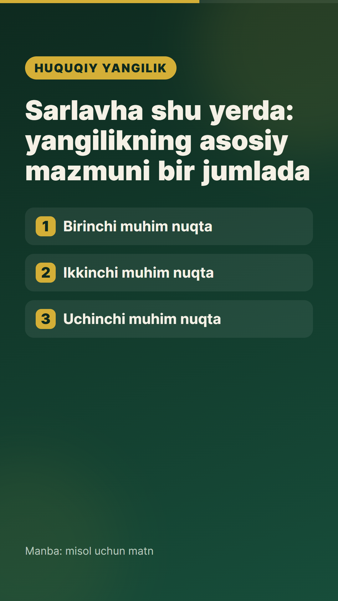
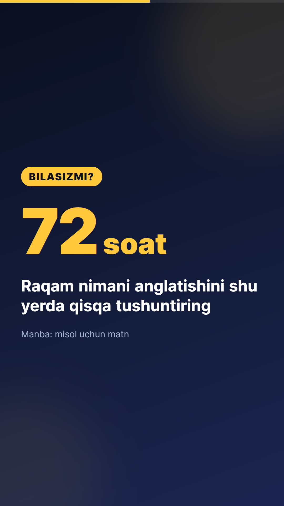
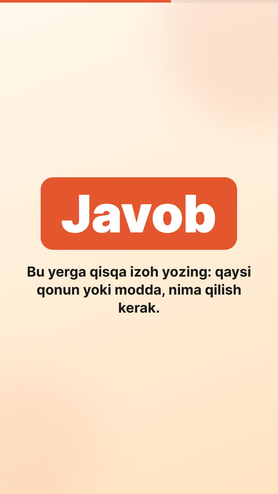

# uz-reels-templates

**Oʻzbek tilidagi Reels, Shorts va TikTok videolari uchun ochiq kodli shablonlar** — [Remotion](https://www.remotion.dev) (React) asosida.

*Open-source, Uzbek-first video templates for vertical short-form content (1080×1920), built with Remotion.*

Matnni almashtiring → mavzuni tanlang → MP4 tayyor. Montaj dasturi shart emas.

<p align="center">
  
  
  
</p>

## Shablonlar

| ID | Nima uchun | Davomiyligi |
|----|-----------|-------------|
| `YangilikReel` | Yangilik: sarlavha + 1–4 ta asosiy nuqta + manba | ~10–14 s (bandlar soniga qarab) |
| `FaktKarta` | "Bilasizmi?" — katta raqam sanaladi + izoh | ~9.5 s |
| `SavolJavob` | Savol → 3-2-1 → javob ochiladi | 12.5 s |

Har bir shablonda:
- 3 ta tayyor rang mavzusi: `tun`, `kun`, `qonun`
- yuqorida progress chizigʻi, oxirida "obuna boʻling" kartasi
- lotin (oʻ, gʻ) va kirill (ў, қ, ғ, ҳ) harflarini toʻgʻri koʻrsatadigan shrift (Inter)

## Ishga tushirish

Kerak: [Node.js](https://nodejs.org) 18+.

```bash
npm install
npm run dev
```

Brauzerda Remotion Studio ochiladi. Chap tomondan shablonni tanlang, oʻng paneldagi maydonlarda matnni tahrirlang va **Render** tugmasini bosing.

Buyruq satridan render:

```bash
npm run render:yangilik
npm run render:fakt
npm run render:savol
```

Oʻz matningiz bilan (JSON orqali):

```bash
npx remotion render YangilikReel out/video.mp4 --props=./misol.json
```

`misol.json`:

```json
{
  "mavzu": "tun",
  "kicker": "YANGILIK",
  "sarlavha": "Sarlavhangiz",
  "bandlar": ["Birinchi nuqta", "Ikkinchi nuqta"],
  "manba": "Manba: ...",
  "cta": "Saqlab qoʻying!",
  "handle": "@sahifangiz"
}
```

> **Windows'da `spawn EFTYPE` xatosi chiqsa** (masalan, loyiha OneDrive papkasida boʻlsa), oʻrnatilgan Chrome'dan foydalaning:
> `npx remotion render YangilikReel out/video.mp4 --browser-executable="C:\Program Files\Google\Chrome\Application\chrome.exe"`

## Loyiha tuzilishi

```
src/
  theme.ts              ranglar, shrift, video oʻlchami
  components/Shared.tsx fon, sarlavha animatsiyasi, outro va boshqalar
  templates/            har bir shablon alohida faylda
  Root.tsx              shablonlarni roʻyxatdan oʻtkazish
```

## Hissa qoʻshish

Yangi shablon, rang mavzusi, tarjima yoki xato tuzatish — hammasi qabul qilinadi. [CONTRIBUTING.md](CONTRIBUTING.md) ni oʻqing.

Gʻoyalar roʻyxati (ishni shulardan boshlashingiz mumkin):
- [ ] Kirill yozuvi uchun namunaviy JSON
- [ ] "Top 5" roʻyxat shabloni
- [ ] Iqtibos (sitata) kartasi
- [ ] Subtitr (soʻzma-soʻz) shabloni
- [ ] Yangi rang mavzulari

## Litsenziya

[MIT](LICENSE) — tijorat maqsadida ham bepul foydalanishingiz mumkin.

> Eslatma: Remotion kutubxonasining oʻz litsenziyasi bor — jismoniy shaxslar va kichik jamoalar uchun bepul, katta kompaniyalar uchun pullik. Batafsil: https://www.remotion.dev/license
